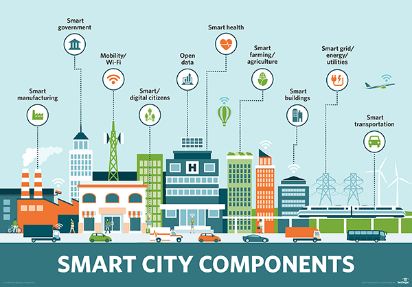

# Introducción a las Smart Cities

## ¿Qué entendemos por Smart City?

Una **Smart City** o ciudad inteligente utiliza información, tecnología y participación ciudadana para mejorar servicios y responder a necesidades urbanas. No consiste solo en instalar sensores: también importa qué problema se quiere resolver, quién usa la información y cómo afecta la solución a las personas.



Por ejemplo, una ciudad puede medir la humedad del suelo de un parque para ayudar a decidir cuándo regar. El sensor produce datos, pero el servicio solo es útil si esos datos llegan a los equipos responsables y les ayudan a tomar una decisión.

La tecnología es una parte del sistema. También hay que considerar la gestión, la sostenibilidad, la accesibilidad, la privacidad y las necesidades de quienes viven y trabajan en la ciudad.


!!! exercise "Ejercicio en clase · 5 minutos"

    En parejas, elegid un problema urbano (por ejemplo, el riego de parques, la accesibilidad del transporte o la recogida de residuos). Anotad:

    1. ¿Qué se quiere mejorar?
    2. ¿Qué datos podrían ayudar?
    3. ¿Quién usaría esos datos y qué decisión tomaría?

    Comentad una posible limitación de la solución. No hace falta entregar el ejercicio.

## De los datos al geoservicio

Un **servicio web** permite que una aplicación solicite información o una función a otro sistema. La aplicación envía una petición y recibe una respuesta siguiendo unas reglas documentadas.

Cuando el servicio trabaja con datos o funciones que tienen una componente geográfica —por ejemplo, coordenadas, geometrías o mapas—, hablamos de un **geoservicio**. En este curso consumiremos servicios para consultar datos urbanos y representarlos en mapas.

Una **API** (interfaz de programación de aplicaciones) describe cómo puede comunicarse una aplicación con un servicio: qué peticiones acepta, qué parámetros se pueden enviar y qué respuestas devuelve. La documentación de una API explica esas reglas.

### Ejemplo: consultar estaciones de bicicletas

Imaginemos que una ciudad ofrece una API para consultar estaciones de bicicletas. Esta petición ficticia solicita las estaciones de un barrio:

```http
GET https://datos.ciudad.example/api/estaciones?barrio=Centro
```

La respuesta podría ser un documento JSON como este:

```json
{
  "estaciones": [
    {
      "id": 42,
      "nombre": "Plaza Central",
      "latitud": 41.38,
      "longitud": 2.17,
      "bicicletas_disponibles": 6
    }
  ]
}
```

En esta petición:

- `GET` indica que queremos consultar información;
- `/api/estaciones` identifica el recurso solicitado;
- `barrio=Centro` es un parámetro que limita la consulta;
- la respuesta contiene datos, incluida la localización de la estación.

Los nombres y datos del ejemplo son ficticios. En una API real, la documentación especifica los parámetros disponibles y el formato de la respuesta.

!!! exercise "Ejercicio en clase · 5–10 minutos"

    Usad el ejemplo anterior para proponer una petición que solicite las estaciones de otro barrio. Después, indicad qué campo de la respuesta permitiría situar cada estación en un mapa y qué campo mostraríais en una ventana informativa.

    No hace falta escribir código ni entregar el ejercicio.

## Peticiones HTTP

Las APIs web suelen comunicarse mediante el protocolo HTTP. Algunos de sus métodos más habituales son:

| Método | Uso habitual |
|---|---|
| `GET` | Consultar o recuperar información. |
| `POST` | Enviar información o realizar una consulta que requiere un cuerpo de petición. |
| `PUT` y `PATCH` | Crear o modificar un recurso, según las reglas del servicio. |
| `DELETE` | Eliminar un recurso, si el servicio lo permite. |

En este curso nos encontraremos sobre todo con peticiones `GET`. Algunas APIs usan `POST` para consultas más complejas. El comportamiento exacto depende de cada servicio y se debe comprobar en su documentación.

### Parámetros en la URL

En muchas peticiones `GET`, los parámetros aparecen después de `?` y se escriben como pares `nombre=valor`. El símbolo `&` separa varios parámetros:

```text
https://datos.ciudad.example/api/incidencias?tipo=baches&estado=abierta
```

Aquí se solicitan incidencias de tipo `baches` cuyo estado sea `abierta`. Las APIs también pueden definir otros caminos y formas de consulta; por eso conviene revisar siempre su documentación.

!!! exercise "Ejercicio en clase · 5 minutos"

    En la URL del ejemplo, identificad el recurso y los dos parámetros. Cambiad uno de los valores para consultar otro tipo de incidencia o estado. ¿Qué información esperaríais recibir?

    Es un ejercicio de lectura de URLs; no hace falta que el servicio ficticio exista ni entregar la respuesta.

## Relación con los datos abiertos

Muchos ayuntamientos y administraciones publican datos mediante portales de **Open Data** o datos abiertos. Algunos ofrecen APIs para consultar los datos desde otras aplicaciones, además de opciones para descargarlos.

En la siguiente página veremos qué son los datos abiertos y cómo se organizan sus portales. Más adelante consultaremos APIs de portales como Socrata y CKAN.

## Referencias

- [Interfaz de programación de aplicaciones (Wikipedia)](https://es.wikipedia.org/wiki/Interfaz_de_programaci%C3%B3n_de_aplicaciones)
