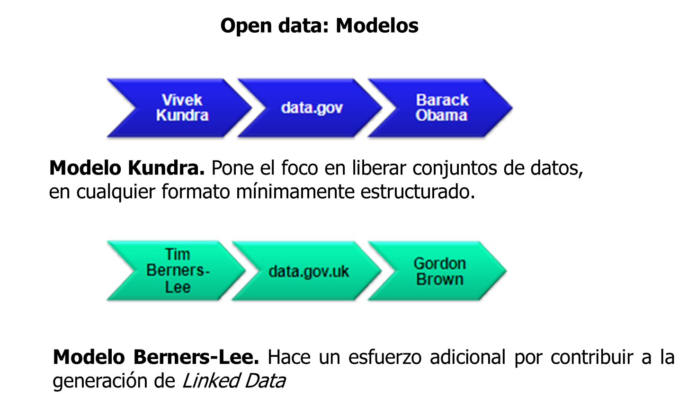

# Introducción a los datos abiertos

## ¿Qué significa que un dato sea abierto?

Los **datos abiertos** son datos que cualquier persona puede consultar, reutilizar, adaptar y compartir, con pocas condiciones, como citar la fuente o compartir las adaptaciones con la misma licencia. Que un dato se pueda ver o descargar no basta para saber si es abierto: hay que comprobar su licencia.

La apertura tiene dos dimensiones:

- **Legal:** la licencia permite reutilizar y compartir los datos.
- **Técnica:** los datos están disponibles en un formato que puede procesarse con herramientas informáticas.

La [Definición de Conocimiento Abierto](https://opendefinition.org/od/2.1/es/) describe estos principios con más detalle.

!!! exercise "Ejercicio en clase · 5 minutos"

    Decidid qué información falta para valorar estos dos casos:

    1. Un ayuntamiento publica una tabla como imagen escaneada y no indica ninguna licencia.
    2. Un portal ofrece un CSV descargable, pero la página del conjunto no indica la licencia.

    ¿Podemos afirmar que alguno de los dos conjuntos es abierto? ¿Qué preguntaríais o buscaríais antes de reutilizarlo? No hace falta entregar el ejercicio.

## Apertura y facilidad de reutilización

Un conjunto puede ser legalmente reutilizable y, aun así, resultar difícil de aprovechar. Para valorar su utilidad, conviene comprobar al menos:

| Qué revisar | Pregunta práctica |
|---|---|
| **Licencia** | ¿Se permite reutilizar y compartir los datos? ¿Hay que atribuir la fuente? |
| **Formato** | ¿Los datos están estructurados y se pueden procesar? Por ejemplo, ¿la tabla está en CSV o solo en una imagen? |
| **Descripción** | ¿Se explican los campos, las unidades y el significado de los valores? |
| **Componente geográfica** | ¿Se indica qué representan las coordenadas y en qué sistema de referencia están? |
| **Actualización y cobertura** | ¿Se indica de cuándo son los datos, con qué frecuencia cambian y qué zona cubren? |
| **Acceso** | ¿Se pueden descargar? ¿Hay también una API? ¿Se explican sus límites o requisitos? |

Una **API facilita el acceso automático**, pero no es un requisito para que los datos sean abiertos. Algunos conjuntos solo ofrecen una descarga; otros permiten descargar los datos y consultarlos mediante una API.

!!! exercise "Ejercicio en clase · 5–10 minutos"

    Elegid un conjunto de datos de un portal Open Data. Revisad su página y anotad la licencia, el formato, la fecha de actualización y una limitación o dato que no quede claro. Si hay API, localizad dónde se indica.

    Podéis usar un portal conocido por el grupo. No hace falta descargar datos ni entregar el análisis.

## Enfoques para publicar datos abiertos

Las etiquetas «modelo estadounidense» y «modelo británico» se usan aquí como **referencias históricas** a dos iniciativas de finales de la década de 2000. No describen de forma completa las políticas actuales de esos países: en la práctica, los enfoques se combinan.

### Publicar conjuntos de datos: la referencia inicial de Estados Unidos

La iniciativa federal estadounidense [Data.gov](https://data.gov/open-gov/index.html), lanzada en 2009, puso el foco en publicar y hacer encontrables conjuntos de datos del Gobierno. La transparencia, la rendición de cuentas y la posibilidad de que otras personas reutilizaran la información eran objetivos centrales. La [directiva de Gobierno Abierto](https://obamawhitehouse.archives.gov/open/documents/open-government-directive) pedía publicar información en formatos abiertos que se pudieran descargar, analizar y visualizar.

**Ventajas:** permite empezar a publicar con rapidez y ofrece datos que ciudadanía, investigación, empresas y otras administraciones pueden reutilizar.

**Límites:** un catálogo grande no garantiza por sí solo que los conjuntos estén bien descritos, actualizados, sean comparables o respondan a necesidades concretas. Publicar archivos es un primer paso, no todo el trabajo de apertura.

### Enlazar datos: la referencia inicial del Reino Unido

Cuando [data.gov.uk se presentó en 2010](https://www.w3.org/news/2010/uk-government-launches-open-data-site/), mostró también tecnologías de **datos enlazados**. Este enfoque promueve identificadores persistentes y estándares que permiten relacionar datos de distintas fuentes y darles más contexto.

**Ventajas:** si distintas fuentes describen lugares, organizaciones o conceptos de manera compatible, resulta más fácil combinar y procesar sus datos automáticamente.

**Límites:** diseñar y mantener identificadores, vocabularios y relaciones requiere conocimientos y coordinación. Aplicar tecnologías semánticas a todos los conjuntos puede añadir trabajo sin mejorar su uso; no es un requisito para publicar datos abiertos.

### Interoperabilidad y reglas comunes: el enfoque europeo

La Unión Europea combina la reutilización de información pública con requisitos comunes. La [Directiva europea sobre datos abiertos](https://eur-lex.europa.eu/legal-content/ES/ALL/?uri=CELEX%3A32019L1024) y las reglas sobre [conjuntos de alto valor](https://datos.gob.es/sites/default/files/blog/file/conjunto-datos-alto-valor-es-doble.pdf) impulsan formatos legibles por máquina y, para esos conjuntos, el acceso mediante API y descarga masiva cuando corresponda. Para la información geográfica, [INSPIRE](https://eur-lex.europa.eu/ES/legal-content/summary/the-eu-s-infrastructure-for-spatial-information-inspire.html) establece requisitos de metadatos, servicios e interoperabilidad para poder descubrir y combinar datos entre distintas administraciones.

**Ventajas:** los requisitos comunes ayudan a que datos de distintos organismos se puedan descubrir, comparar y utilizar conjuntamente; también dan previsibilidad a quienes los reutilizan.

**Límites:** aplicar normas y armonizar datos puede exigir tiempo, coordinación y recursos. Cumplir una especificación no garantiza por sí solo que un servicio sea fácil de encontrar o consumir. Además, **INSPIRE e “información abierta” no son sinónimos**: las condiciones de acceso y reutilización dependen de cada dato y de sus restricciones legales.

### Publicar según las necesidades de reutilización

Otro enfoque complementario consiste en preguntar a quienes podrían reutilizar los datos qué necesitan y priorizar conjuntos de acuerdo con su utilidad pública y sus posibles usos. La demanda puede conocerse mediante consultas, solicitudes recibidas, colaboración con usuarios o análisis de aplicaciones existentes.

Esto ayuda a priorizar datos útiles y a mejorar su documentación. Si solo se atienden las peticiones más frecuentes o las de los grupos con más recursos, pueden quedar fuera necesidades menos visibles. Por eso, la demanda debe complementar los criterios de interés público y las obligaciones de publicación.

### ¿Qué combinación resulta más útil?

No hace falta elegir un único modelo. Una iniciativa práctica puede combinar sus ventajas:

1. **Publicar** datos con una licencia clara, en un formato procesable y con documentación suficiente.
2. **Facilitar el acceso** con descarga y, cuando aporte valor —por ejemplo, para datos dinámicos o consultas frecuentes—, una API.
3. **Usar estándares e identificadores comunes** cuando ayuden a combinar datos de distintas fuentes; reservar Linked Data para los casos en que justifique su coste.
4. **Escuchar a quienes los reutilizan** y mantener los conjuntos, corrigiendo errores y explicando cambios.
5. **Proteger lo que no se puede abrir**, como información personal o datos sujetos a restricciones legítimas.

El objetivo no es publicar el mayor número posible de archivos ni aplicar la tecnología más compleja a todos los datos. Es conseguir que la información de interés público se pueda encontrar, entender y reutilizar de forma segura y sostenible.

!!! exercise "Ejercicio en clase · 8–10 minutos"

    Una ciudad quiere publicar datos sobre la accesibilidad de las paradas de autobús. En grupos, decidid qué pasos daríais primero:

    - publicar un archivo descargable;
    - añadir una licencia, descripción y fecha de actualización;
    - ofrecer una API y una descarga completa;
    - acordar identificadores comunes para las paradas y las líneas;
    - consultar a personas usuarias y a quienes mantienen el transporte.

    Elegid tres pasos, ordenadlos y explicad una ventaja y un coste de vuestra propuesta. No hay un único orden correcto y no hace falta entregar el ejercicio.

## Portales y plataformas de publicación

Un **portal de datos abiertos** permite descubrir conjuntos de datos y consultar su descripción, licencia y recursos disponibles. El portal también puede proporcionar enlaces de descarga, visualizaciones o APIs.

### Portales Open Data e IDE: diferencias y relación

Un portal Open Data y una **Infraestructura de Datos Espaciales (IDE)** pueden publicar y dar acceso a información geográfica, pero tienen alcances distintos. El portal Open Data se centra en que los datos públicos puedan encontrarse y reutilizarse; una IDE organiza la publicación y el acceso interoperable a información geográfica mediante datos, metadatos, servicios, normas y acuerdos entre las organizaciones participantes.

| Aspecto | Portal Open Data | IDE |
|---|---|---|
| **Alcance** | Datos de muchos temas: presupuestos, transporte, salud, medio ambiente, cartografía, entre otros. | Información geográfica y los componentes necesarios para descubrirla y utilizarla de forma interoperable. |
| **Recursos habituales** | Fichas de conjuntos, licencias, archivos descargables, APIs y, a veces, visualizaciones. | Datos geográficos, metadatos, catálogos y servicios de visualización, descarga o procesamiento; también normas y acuerdos de coordinación. |
| **Interoperabilidad** | Puede facilitarla con formatos, metadatos y APIs comunes, pero su grado varía según el portal y el conjunto. | Es uno de sus objetivos explícitos: que datos y servicios geográficos de diferentes nodos puedan descubrirse y combinarse. |
| **Tipo de información** | Puede incluir datos geográficos y no geográficos. | Se ocupa específicamente de información geográfica; su existencia no implica que todos los datos sean abiertos. |

**Se parecen y se complementan:** ambos pueden incluir catálogos, metadatos y enlaces a datos o servicios. Un conjunto geográfico puede aparecer en un portal Open Data como descarga, y también describirse en un catálogo de una IDE que enlaza a un servicio de mapas o descarga. Los catálogos nacionales y europeos pueden reunir metadatos de fuentes distintas, sin que necesariamente almacenen una copia de los datos.

**¿Siguen siendo necesarias las IDE? Sí.** Un portal Open Data no sustituye por sí solo una IDE: publicar un archivo para descargar no resuelve automáticamente cómo describir su referencia espacial, localizar servicios geográficos, combinar capas de distintas administraciones o mantener su interoperabilidad. A la vez, una IDE no sustituye a un portal Open Data general, que puede hacer accesibles datos de muchos ámbitos y destacar sus condiciones de reutilización. En la práctica, algunos portales comparten componentes o funciones; importa el servicio que ofrecen, no solo el nombre que reciben.

La apertura tampoco se deduce de que un dato esté en una IDE o en un portal Open Data: hay que revisar la licencia y las condiciones de acceso de cada recurso. En España, la [definición de IDE del Instituto Geográfico Nacional](https://www.ign.es/web/ign/portal/preguntas-frecuentes) incluye datos georreferenciados, metadatos, servicios interoperables, normas y acuerdos de coordinación. El [geoportal de la IDEE](https://www.idee.es/) permite explorar un ejemplo de esta infraestructura. En el curso de IDE se estudian con más detalle sus normas, metadatos y servicios; aquí nos centraremos en descubrir y consumir datos abiertos.

!!! exercise "Ejercicio en clase · 5 minutos"

    Para buscar las paradas de autobús de una ciudad, ¿empezarías por su portal Open Data, por el catálogo de una IDE o por ambos? Indicad qué esperaríais encontrar en cada sitio y qué revisaríais antes de utilizar los datos. No hace falta entregar el ejercicio.

### Ejemplos de portales y directorios

Para localizar datos, suele ser más eficaz empezar por un catálogo oficial de la zona o del organismo responsable y ampliar la búsqueda a otros portales si hace falta. Estos ejemplos ilustran distintos niveles:

| Tipo | Ejemplo | Qué permite explorar |
|---|---|---|
| **Municipal** | [Open Data BCN](https://opendata-ajuntament.barcelona.cat/data/es/dataset) | Conjuntos publicados por el Ayuntamiento de Barcelona, con temas urbanos como movilidad, población y servicios municipales. |
| **Estatal** | [Catálogo de datos.gob.es](https://datos.gob.es/es/catalogo/servicios-datos) | Datos de organismos públicos españoles y recursos asociados; el catálogo incluye conjuntos y servicios de datos. |
| **Europeo y federado** | [data.europa.eu](https://data.europa.eu/es) | Búsqueda de conjuntos y catálogos procedentes de instituciones y países europeos. Sirve como punto de descubrimiento y puede enlazar con la fuente original. |
| **Internacional** | [Data.gov](https://data.gov/) | Catálogo de datos del Gobierno de Estados Unidos. |
| **Geoespacial (IDE)** | [Infraestructura de Datos Espaciales de España (IDEE)](https://www.idee.es/) y [geoportal del IGN](https://www.ign.es/web/ign/portal/ide-area-nodo-ide-ign) | Catálogos, metadatos y servicios de información geográfica; son referencias para buscar recursos espaciales interoperables. |

Si todavía no sabes qué país, administración o plataforma publica el dato, estos directorios ayudan a descubrir portales:

- [Catálogo de datos.gob.es](https://datos.gob.es/es/catalogo/servicios-datos): catálogo nacional que integra metadatos de organismos y catálogos federados en España.
- [data.europa.eu](https://data.europa.eu/es): catálogo europeo que agrupa conjuntos y catálogos de distintos países y organizaciones.
- [DataPortals.org](https://dataportals.org/search): directorio comunitario internacional de portales. Es útil para encontrar candidatos, pero conviene comprobar que cada enlace y portal siga activo y que el catálogo sea oficial para el organismo que buscamos.

Los directorios no garantizan que todos los portales estén incluidos ni que sus conjuntos estén actualizados. Una vez encontrado un conjunto, abre su ficha en el portal de origen y comprueba licencia, fecha, cobertura, formato y mecanismo de acceso.

CKAN y Socrata son plataformas utilizadas para publicar y gestionar catálogos de datos. En este curso las veremos como formas distintas de localizar y consultar datos:

| Plataforma | Qué veremos en este curso |
|---|---|
| **CKAN** | Buscar conjuntos en el catálogo y reconocer sus recursos. Algunas instalaciones permiten consultar registros directamente mediante la DataStore API; en otras, el recurso se descarga o se sirve desde otro sistema. |
| **Socrata** | Localizar el endpoint de un conjunto y consultar datos mediante la SODA API. |

La disponibilidad de una API y sus funciones dependen de cómo esté configurada cada plataforma y de cómo se haya publicado el conjunto. En la [siguiente página](2_1_api_socrata.md) seguiremos un ejemplo completo con Socrata. Después, quien quiera comparar otra plataforma puede consultar la página [opcional sobre CKAN](2_2_api_ckan_opcional.md).

!!! exercise "Ejercicio en clase · 5 minutos"

    En un portal Open Data, localizad un conjunto de datos y seguid el camino desde su ficha hasta el archivo o servicio que contiene los datos. ¿Qué información de la ficha os ayuda a decidir si podéis utilizarlo?

    No hace falta llamar a la API ni entregar el ejercicio.

## Ampliación: datos enlazados

Los [**datos enlazados**](https://es.wikipedia.org/wiki/Datos_enlazados) (*Linked Data*) usan identificadores web y enlaces para relacionar información publicada en distintos conjuntos. Por ejemplo, un registro de una parada de autobús podría enlazar con la información del barrio donde está situada.

El modelo de cinco estrellas de [datos abiertos enlazados](https://datos.gob.es/sites/default/files/doc/file/guia-publicacion-datos-enlazados_3.pdf) describe una progresión desde publicar datos en la Web con una licencia abierta hasta enlazarlos con otros datos. Es una ampliación conceptual; en este curso nos centraremos en localizar, evaluar y consumir los datos.

## Referencias

- [Definición de Conocimiento Abierto (español)](https://opendefinition.org/od/2.1/es/)
- [Guía para la publicación de APIs, con apartados sobre CKAN y Socrata (datos.gob.es, español)](https://datos.gob.es/sites/default/files/doc/file/guia_publicacion_apis.pdf)
- [Directiva europea sobre datos abiertos y reutilización de la información del sector público (texto en español)](https://eur-lex.europa.eu/legal-content/ES/ALL/?uri=CELEX%3A32019L1024)
- [Data.gov: iniciativa de datos abiertos del Gobierno de Estados Unidos (inglés)](https://data.gov/open-gov/index.html)
- [Directiva de Gobierno Abierto de Estados Unidos (archivo de la Casa Blanca, inglés)](https://obamawhitehouse.archives.gov/open/documents/open-government-directive)
- [Presentación de data.gov.uk y tecnologías de datos enlazados (W3C, inglés)](https://www.w3.org/news/2010/uk-government-launches-open-data-site/)
- [API de CKAN (documentación oficial, inglés)](https://docs.ckan.org/en/latest/api/)
- [DataStore de CKAN (documentación oficial, inglés)](https://docs.ckan.org/en/latest/maintaining/datastore.html)
- [Introducción a la SODA API de Socrata (documentación oficial, inglés)](https://dev.socrata.com/consumers/getting-started)
- [Preguntas frecuentes sobre las IDE (Instituto Geográfico Nacional)](https://www.ign.es/web/ign/portal/preguntas-frecuentes)
- [Infraestructura de Datos Espaciales de España (IDEE)](https://www.idee.es/)
- [Federar un catálogo con datos.gob.es](https://datos.gob.es/es/preguntas-frecuentes/como-federar-mi-catalogo-de-datos-abiertos-con-datosgobes)
- [DataPortals.org: directorio internacional de portales](https://dataportals.org/about/)

**Siguiente:** [API de Socrata](2_1_api_socrata.md).
